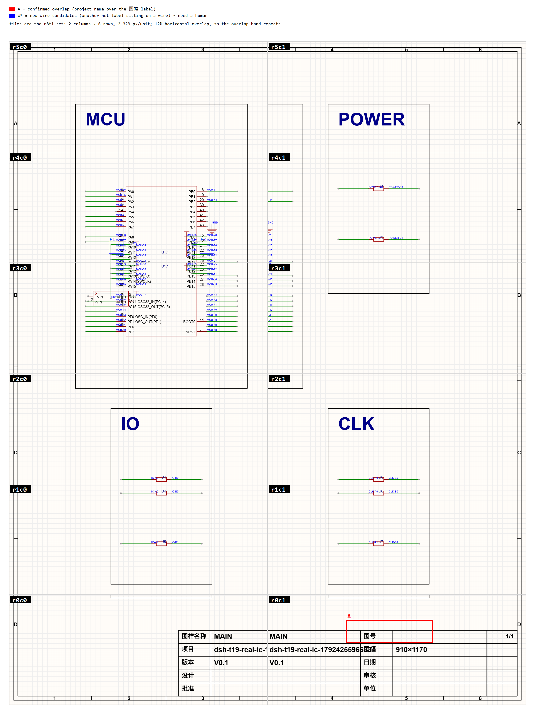

# MAIN 高清图块索引与第三类判定（r9t1，2026-10-22 按主持人识图改判）

> 只读产出。图来自 `r8t1`：12 块分块（2 列 × 6 行，相邻重叠 12%，**2.323 px/单位**）+ 4 张特写（**5.405 px/单位**）。页坐标范围与 sha256 以 `docs/evidence/current/r8t1-main-hires-tiles.json` 为准，本索引逐条核对过文件存在性与哈希。

## 一眼定位

12 块按 2×6 拼回整页，每块左上角标 `rXcY`；**红框 A** 记录的是**D1 修复前**已确认的**文字-文字**重叠（`text31` 当时 16pt，项目名的尾部越出自身单元格、压到 `text32`「图幅」14pt，证据 `r8t1-main-closeup-2.png`，范围 (560, 104)–(700, 130)）；该溢出已由 **D1** 把 `text31` 收到 **14pt**，实测墨迹右界 **579.63**、距格线 583.68 **内缩 4.05**，见 `r4t1-d1-text31-shrink.json` 与 `r4t3-review-d1.json`；**蓝框 W\*** 的两处本轮已按主持人识图改判为**文字-文字**，不再是"导线穿字"候选（证据 `r8t1-main-tile-r4c0.png`，W1 (196, 783)–(224, 807)、W2 (376, 783)–(404, 807)）；r2t1 的 8.25 px/单位定标把对象进一步分开——W1 压**引脚编号 31**，`attr102` 只擦过导线，压引脚名的是同排**标志名**，见下方「W1/W2 改判」与 2026-10-24 更正块。

> **看图注意（拼图缝）**：这张整页图是把 12 块逐块平铺画在 `col × 1189` 的位置上拼的（`r9t1-main-view-guide.mjs` L379-386），**没有裁掉相邻块 12% 的共享带**（`r0c0` 覆盖到 x=509.8，`r0c1` 从 x=400.2 起，共享带 400.2–509.8 被画了两遍）。所以标题栏里 `图样名称 MAIN|MAIN`、`项目 dsh-t19-real-ic-1…|…633`、`版本 V0.1|V0.1` 的"重复"是**拼图产物，不是文档内容重复**。判内容是否重复请看单块图（`r8t1-main-tile-r0c1.png`）或 `closeup-2`，不要看这张合成图。

## 12 块分块

| 块 | 文件 | 页坐标范围 | px/单位 | 值得看的东西 |
|---|---|---|---|---|
| r0c0 | `r8t1-main-tile-r0c0.png` | (-2, -2) - (509.8, 216.7) | 2.323 | 器件：— 文字："图样名称", "MAIN", "项目", "dsh-t19-real-ic-17", "版本", "V0.1" 网络名：— |
| r0c1 | `r8t1-main-tile-r0c1.png` | (400.2, -2) - (912, 216.7) | 2.323 | 器件：— 文字："MAIN", "图号", "dsh-t19-real-ic-17", "图幅", "910×1170", "V0.1" 网络名：— |
| r1c0 | `r8t1-main-tile-r1c0.png` | (-2, 189.5) - (509.8, 408.1) | 2.323 | 器件：U4, U5 文字：— 网络名：IO-A0, IO-A1, IO-B0, IO-B1 |
| r1c1 | `r8t1-main-tile-r1c1.png` | (400.2, 189.5) - (912, 408.1) | 2.323 | 器件：U6, U7 文字：— 网络名：CLK-A0, CLK-A1, CLK-B0, CLK-B1 |
| r2c0 | `r8t1-main-tile-r2c0.png` | (-2, 380.9) - (509.8, 599.6) | 2.323 | 器件：U4 文字："C", "IO" 网络名：IO-A0, IO-B0 |
| r2c1 | `r8t1-main-tile-r2c1.png` | (400.2, 380.9) - (912, 599.6) | 2.323 | 器件：U6 文字："C", "CLK" 网络名：CLK-A0, CLK-B0 |
| r3c0 | `r8t1-main-tile-r3c0.png` | (-2, 572.4) - (509.8, 791.1) | 2.323 | 器件：U1, U?, layout:flag:MCU_17:0(flag), layout:flag:MCU_22:0(flag), layout:flag:MCU_25:0(flag), layout:flag:MCU_29:0(flag), layout:flag:MCU_30:0(flag), layout:flag:MCU_31:0(flag) 文字："B" 网络名：+3V3, MCU-17, MCU-22, MCU-25, MCU-29, MCU-30, MCU-31, MCU-32, MCU-33, MCU-10 |
| r3c1 | `r8t1-main-tile-r3c1.png` | (400.2, 572.4) - (912, 791.1) | 2.323 | 器件：— 文字："B" 网络名：— |
| r4c0 | `r8t1-main-tile-r4c0.png` | (-2, 763.9) - (509.8, 982.5) | 2.323 | 器件：U1, layout:flag:GND:bus:360(flag), layout:flag:MCU_22:0(flag), layout:flag:MCU_25:0(flag), layout:flag:MCU_26:0(flag), layout:flag:MCU_27:0(flag), layout:flag:MCU_28:0(flag), layout:flag:MCU_31:0(flag) 文字：— 网络名：GND, MCU-22, MCU-25, MCU-26, MCU-27, MCU-28, MCU-31, MCU-32, MCU-33, MCU-34 |
| r4c1 | `r8t1-main-tile-r4c1.png` | (400.2, 763.9) - (912, 982.5) | 2.323 | 器件：U2, U3 文字：— 网络名：POWER-A0, POWER-A1, POWER-B0, POWER-B1 |
| r5c0 | `r8t1-main-tile-r5c0.png` | (-2, 955.3) - (509.8, 1174) | 2.323 | 器件：— 文字："1", "2", "3", "A", "MCU" 网络名：— |
| r5c1 | `r8t1-main-tile-r5c1.png` | (400.2, 955.3) - (912, 1174) | 2.323 | 器件：— 文字："4", "5", "6", "A", "POWER" 网络名：— |

## 4 张特写

| 特写 | 文件 | 页坐标范围 | px/单位 | 为什么拍它（r8t1 原始意图） | 框内实际锚点对象 |
|---|---|---|---|---|---|
| closeup-1 | `r8t1-main-closeup-1.png` | (778, 95) - (998, 189) | 5.405 | 核对 t55 的最近文字对（text41 `1/1` / text61 `D`，锚点相距 22.8 单位）是否真重叠 | "1/1" 14pt, "D" 12pt |
| closeup-2 | `r8t1-main-closeup-2.png` | (480, 95) - (700, 189) | 5.405 | **D1 改前**的 16pt 项目名 text31 尾部越出单元格、压到 text32「图幅」——文字-文字的真实实例（本图是改前留证；现为 14pt，墨迹右界 579.63，不再越格） | "图号" 14pt, "图幅" 14pt, "910×1170" 16pt |
| closeup-3 | `r8t1-main-closeup-3.png` | (230, 95) - (450, 189) | 5.405 | text27「图样名称」锚点落在 rect0 内（锚点包含关系，不等于字形重叠） | "图样名称" 14pt, "MAIN" 16pt, "项目" 14pt, "dsh-t19-real-ic-179242" 16pt（D1 改前；现 14pt） |
| closeup-4 | `r8t1-main-closeup-4.png` | (-42, 21) - (178, 115) | 5.405 | rect0 包含 rect1（面积 999164），验证矩形嵌套 | （框内无锚点对象） |

> **修正（r9t2 复核指出）**：closeup-2 的 r8t1 说明写的是"最近文字-符号 151 单位（text29 图号 / u7）"，但 u7 在 (620, 290)，落在裁剪框 (480, 95)–(700, 189) **之外**，画面里根本没有它——**该坐标已从上表删除**。这张图真正拍到的是 `text31`（项目名，**拍这张图时是 16pt**，起于 404,116）的尾部越出单元格、压到 `text32`（「图幅」，14pt，590,116）上——是**文字-文字**，不是文字-符号。该帧是 **D1 改前**的留证；`text31` 现为 **14pt**，墨迹右界 579.63、距格线 583.68 内缩 4.05，不再越格（`r4t1-d1-text31-shrink.json`）。

## 三类问题的当前状态

| 类别 | 结论 | 证据文件 | 坐标框 |
|---|---|---|---|
| 文字-文字 | **两组真实实例**：① **D1 改前** `text31`（16pt 项目名，404,116）越格压 `text32`（14pt「图幅」，590,116）——排版溢出，非内容重复（该例已由 D1 收到 **14pt** 修复：墨迹右界 579.63，距格线 583.68 **内缩 4.05**）；② 网名压**引脚编号**：W1 的 `MCU-34` 压 `PA10` 的引脚号 `31`，`MCU-33` 压 `32`；另有一处**网络标志名**压**引脚名**（`MCU-26` 的标志名压 `PB10`），见下节与 r2t1。**旧表述「`MCU-34` 压 `PA10`（引脚名）」已作废**——8.25 px/单位下 `PA10` 字形完整可读，被压的是它的引脚号。反例：`text41`/`text61` 锚点相距 22.8，**不是**重叠 | ① `r8t1-main-closeup-2.png`；② `r8t1-main-tile-r4c0.png`；反例 `r8t1-main-closeup-1.png` | ① (560,104)–(700,130) 红框 A；② W1 (196,783)–(224,807)、W2 (376,783)–(404,807) |
| 文字-符号 | **几何不可判**：符号无包围框、`sch_PrimitivePin` 返回 0 个图元，算不出"文字压符号" | 无（几何不可判，不提供断言） | 无 |
| 导线穿字 | **判不了**（原「有候选 2 处」作废）。原先的 W1/W2 两处经主持人识图改判为**文字-文字**：像素上 W1 的 `MCU-34` 压的是 U1 引脚**编号 31**（`PA10` 的 Pin Number；`PA10` 字形 252–268 完整可读）；W2 的 `attr102` 本身只擦过导线，压 `PB10` 的是同排**网络标志名**。几何上标签到导线的 `d=5.0` 只有半个 14pt 字高、`t=0.75` 贴着引脚端——不是穿中段；旧的 `t=0.25` 是步长 2 伪斜线读数，**已作废**，仅作历史记录。是否还有真正的"导线穿字"**仍为判不了**：r2t1 的 8.25 px/单位特写里，W2 的 `attr102` 墨迹（409.8–428.9）下方**没有任何黑色字形**，只有一根绿线从字框底边掠过（框内绿色像素 485、只跨 2 行，约 0.5 单位），压不到笔画 | 无（判不了，不提供断言）；改判证据 `r8t1-main-tile-r4c0.png` | W1 (196,783)–(224,807)、W2 (376,783)–(404,807)（蓝框现标"文字-文字"，不再是导线候选） |
| 导线穿符号 | **判不了**（几何不可判：符号无包围框、`sch_PrimitivePin` 返回 0 个图元）；按声明规则筛完 0 条，原始规则 14 条**全部落在导线端点**，属接线非穿越——这只能说明"便宜的规则找不到候选"，不等于画面没有 | `r8t1-main-tile-r3c0.png`、`r8t1-main-tile-r4c0.png` | 见下表 14 行（仅作规则记录，不作结论） |

> 上表沿用 r8t1 §14.35.18 的口径：closeup-2 记为**文字-文字**；"文字-符号"独立成类、如实标注不可判，不再借用文字证据。
>
> **第三类总判定（2026-10-22 改判；其中 `text31` 一项已由 D1 修复，见下）**：**文字-文字 = 已证实**——A 框 `text31` 压 `text32` 是**D1 改前**的实例（当时 16pt 越格；**已由 D1 收到 14pt**：实测墨迹右界 **579.63**、距格线 583.68 **内缩 4.05**、`图幅` 格内无外来墨迹，证据 `r4t1-d1-text31-shrink.json`／`r4t3-review-d1.json`；此条保留为"该重叠确实存在过"的历史证据，不再代表现状）；**当前仍然成立的文字-文字实例是 W1/W2 那一组**（W1 压引脚编号 `31`，网络标志名压 `PB10`，见下表与 r2t1 定标）；**文字-符号 = 几何不可判**；**导线穿字 = 判不了**（原 2 处候选已改判为文字-文字，"有候选 2 处"的说法作废）；**导线穿符号 = 判不了**（声明规则 0 条、原始 14 条全在端点，二者都只说明规则看不见，不足以下结论）。

## 第三类的算法与阈值（可复算）

- **导线**：`sch_PrimitiveWire.Line` 是扁平坐标序列；**本生成器当前按「相邻两点构成一段」（步长 2）遍历**，本页 55 条导线共 69 段。该步长正在复核：按「每 4 个数一段」读是 62 段、结论会变——两个读数都由代码算出，见文末「解析步长」。
- **文字的两套来源**：`sch_PrimitiveText` 只有 39 条；真正的文字大头是 `sch_PrimitiveAttribute`——662 条。只用前者会得出"没有候选"的错误结论。
- **规则的五个条件，每条都能指到生成器行号**（本文件的当前版本，行号由脚本读取自身源码生成，不是手写）：

| # | 条件 | 生成器位置 | 本页剩余 |
|---|---|---|---|
| 1 | 锚点有 X/Y | `L147` | 342 |
| 2 | `Value` 非空 | `L150` | 342 |
| 3 | $d \le 6$ 且 $t \in (0.05, 0.95)$（文字锚点；12 单位是器件锚点代理，见下） | `L162` | 47 |
| 4 | `ValueVisible !== false`（**不可见的属性不渲染，因此不构成画面上的压字**） | `L169` | 34 |
| 5 | 归属分类 `own-wire-label` / `pin-annotation` / `other` | 同上循环内 `owner` 计算 | other 2 |

- **关于条件 4 的选择与理由**：这里**保留** `ValueVisible === false` 的过滤，因为被过滤的 13 条属性在编辑器里根本不绘制——不可见的东西不可能在视觉上压住任何东西。为了让不同意的人能自己判断，这 13 条**全部列出**在下表；把它们加回来就是"原始 47 条"。**这是本任务明确声明的取舍，不是隐藏的过滤**。
- **为什么排除 $t$ 的端点**：导线**终止**在锚点上是接线，不是穿越。本页 14 个"$d\le 12$"命中里 **14/14 的 $t=1$**，即全部是线端接线。
- **为什么排除 netflag**：13/14 命中是网络标志，它们的锚点就是接线点，按定义不可能"穿过"符号本体。
- **12 单位的依据**：本页小网络标志字形本体半径约 10–12 单位；由于 API 不给宽高，这是**代理值**，不是实测包围框——已在结论里标为不可判类的一部分。
- **归属分类**（决定 attribute 命中是不是真候选）：`own-wire-label`（标签属于它所在的那条线，正常）/ `pin-annotation`（`ParentPrimitiveId` 以 `-eNN` 结尾，画在符号体内的管脚标注，正常）/ `other`（别的网络的标签压在导线上，**候选**）。
- 本页结果：漏斗 342 → 342 → 47 → **34**（可见；该口径用步长 2，步长 4 下为 32，见文末），其中 32 条管脚标注、0 条自有标签、**2 条 other**。

> **替代声明**：`r9t3` L41 的『逐字实现』指控**针对 `430f3be` 那一版，在该版成立**——该版 L56 确写『规则（代码逐字实现下面这一条）』（`git grep -n '代码逐字实现' 430f3be -- docs/evidence/current/r9t1-main-view-guide.md` 命中），而规则缺 `ValueVisible` 条件（`git grep ValueVisible 430f3be -- docs/evidence/current/r9t1-main-view-guide.md` **零命中**；⚠️ **必须限定到指南这一个文件**——不限路径的全树检索会命中 **10 个文件**（含生成器 `r9t1-main-view-guide.mjs` 与 `t31-dataset.json`），照敲裸命令 `git grep ValueVisible 430f3be` 会得到"到处都有"的相反结论），该版指南 blob 为 `1c77c475`，与 `r9t3-review-view-guide-v2.json` 自己记录的 `head: 430f3be` / blob `1c77c475` 一致。该版已在 **`dd5e835`** 改为五条件表、把 `ValueVisible` 列为条件 4 并全表列出 13 条被排除项；**故该指控不适用于现版，不应再被重开**。（本段是登记，不是判词：`r9t3` 原文与 `430f3be`/`dd5e835` 均未被改动，只作引用。）

### 被条件 4 排除的 13 条（`ValueVisible === false`，不渲染，供读者自行加回）

| # | 属性 | 父级 | 值 | 页坐标 | 距离 | t | 压到的导线/网络 | 落在 |
|---|---|---|---|---|---|---|---|---|
| 1 | 379e7e26aef45c70 | u1-e44 | `BI` | (210, 795) | 0 | 0 | layout:wire:_3V3:flags / +3V3 | tile-r4c0 |
| 2 | afb2f2b3dbc67474 | u1-e108 | `BI` | (390, 795) | 0 | 0 | layout:wire:GND:flags / GND | tile-r4c0 |
| 3 | 4792e27d3ce4e44a | layout:flag:_3V3:bus:240-e9 | `Undefined` | (155, 715) | 0 | 0 | layout:wire:MCU_16 / MCU-16 | tile-r3c0 |
| 4 | 5856aa1d5119f4b9 | layout:flag:_3V3:bus:240-e17 | `Undefined` | (245, 725) | 0 | 0 | layout:wire:MCU_17:flags / MCU-17 | tile-r3c0 |
| 5 | 47143b57776db1e2 | layout:flag:GND:bus:360-e15 | `Pin1` | (400, 830) | 0 | 0 | layout:wire:GND:flags / GND | tile-r4c0 |
| 6 | f48d24f68e95cc3e | layout:flag:GND:bus:360-e15 | `1` | (399, 830) | 1 |  | layout:wire:GND:flags / GND | tile-r4c0 |
| 7 | f9c91d843d4c4f0d | layout:flag:MCU_17:0-e11 | `IN` | (236, 723) | 2 |  | layout:wire:MCU_17:flags / MCU-17 | tile-r3c0 |
| 8 | 60fdc482b070f3d0 | layout:flag:MCU_29:0-e11 | `IN` | (236, 743) | 2 |  | layout:wire:MCU_29:flags / MCU-29 | tile-r3c0 |
| 9 | ff1cb68bf276794c | layout:flag:MCU_30:0-e11 | `IN` | (236, 753) | 2 |  | layout:wire:MCU_30:flags / MCU-30 | tile-r3c0 |
| 10 | afcfd249d9f5b070 | layout:flag:MCU_31:0-e11 | `IN` | (236, 763) | 1.94 |  | layout:wire:_3V3:flags / +3V3 | tile-r3c0 |
| 11 | e53904ba70b24fad | layout:flag:MCU_32:0-e11 | `IN` | (236, 773) | 1.94 |  | layout:wire:_3V3:flags / +3V3 | tile-r3c0 |
| 12 | 682ecca3d82574c5 | layout:flag:MCU_33:0-e11 | `IN` | (236, 783) | 0.89 |  | layout:wire:_3V3:flags / +3V3 | tile-r3c0 |
| 13 | 56d794c058111f23 | layout:flag:MCU_34:0-e11 | `IN` | (236, 793) | 2 |  | layout:wire:MCU_34:flags / MCU-34 | tile-r4c0 |

> 把上表 13 条加回，就是"原始 47 条中段命中"；本指南的结论只基于可见的 34 条。

### 不排除端点与 netflag 时的全部 14 条命中（供读者自行判断）

| # | 器件 | 类型 | 页坐标 | 距离 | t | 是否端点 | 导线/网络 | 落在 |
|---|---|---|---|---|---|---|---|---|
| 1 | U? | part | (200, 720) | 0 | 1 | **是** | layout:wire:_3V3:flags / +3V3 | tile-r3c0 |
| 2 | layout:flag:GND:bus:360 | netflag | (400, 840) | 0 | 1 | **是** | layout:wire:GND:flags / GND | tile-r4c0 |
| 3 | layout:flag:MCU_17:0 | netflag | (250, 725) | 0 | 1 | **是** | layout:wire:MCU_17:flags / MCU-17 | tile-r3c0 |
| 4 | layout:flag:MCU_22:0 | netflag | (350, 775) | 0 | 1 | **是** | layout:wire:MCU_22:flags / MCU-22 | tile-r3c0 |
| 5 | layout:flag:MCU_25:0 | netflag | (350, 785) | 0 | 1 | **是** | layout:wire:MCU_25:flags / MCU-25 | tile-r3c0 |
| 6 | layout:flag:MCU_26:0 | netflag | (350, 795) | 0 | 1 | **是** | layout:wire:MCU_26:flags / MCU-26 | tile-r4c0 |
| 7 | layout:flag:MCU_27:0 | netflag | (350, 805) | 0 | 1 | **是** | layout:wire:MCU_27:flags / MCU-27 | tile-r4c0 |
| 8 | layout:flag:MCU_28:0 | netflag | (350, 815) | 0 | 1 | **是** | layout:wire:MCU_28:flags / MCU-28 | tile-r4c0 |
| 9 | layout:flag:MCU_29:0 | netflag | (250, 745) | 0 | 1 | **是** | layout:wire:MCU_29:flags / MCU-29 | tile-r3c0 |
| 10 | layout:flag:MCU_30:0 | netflag | (250, 755) | 0 | 1 | **是** | layout:wire:MCU_30:flags / MCU-30 | tile-r3c0 |
| 11 | layout:flag:MCU_31:0 | netflag | (250, 765) | 0 | 1 | **是** | layout:wire:MCU_31:flags / MCU-31 | tile-r3c0 |
| 12 | layout:flag:MCU_32:0 | netflag | (250, 775) | 0 | 1 | **是** | layout:wire:MCU_32:flags / MCU-32 | tile-r3c0 |
| 13 | layout:flag:MCU_33:0 | netflag | (250, 785) | 0 | 1 | **是** | layout:wire:MCU_33:flags / MCU-33 | tile-r3c0 |
| 14 | layout:flag:MCU_34:0 | netflag | (250, 795) | 0 | 1 | **是** | layout:wire:MCU_34:flags / MCU-34 | tile-r4c0 |

> 这 14 条按原始规则（仅 $d\le 12$）全部成立；按上方的完整规则，因 $t=1$ 且多为 netflag，**全部被排除**，故"导线穿符号"记为**无候选**。两种读法都列出来，读者不必相信我的过滤。
- **符号**：`getState_` 没有宽高，`sch_PrimitivePin` 返回 **0 个图元**，拿不到包围框；器件锚点代理（12 单位）在排除端点后命中 0 条，因此本任务不对"导线穿符号"下结论——**几何不可判**。

### 导线 × 文字图元（39 条）

命中：0 对。为了让"无命中"可被质疑，下面附最近距离——最近的文字图元离任何导线仍有 **130** 单位，远大于 6 单位阈值。

| 最近 | 文字 | 内容 | 页坐标 | 最近距离 | 最近导线/网络 |
|---|---|---|---|---|---|
| 1 | text65 | `POWER` | (540, 910) | 130 | layout:wire:POWER_A0 / POWER-A0 |
| 2 | text67 | `IO` | (220, 390) | 130 | layout:wire:IO_A0 / IO-A0 |
| 3 | text69 | `CLK` | (540, 390) | 130 | layout:wire:CLK_A0 / CLK-A0 |
| 4 | text63 | `MCU` | (150, 905) | 135 | layout:wire:MCU_36 / MCU-36 |
| 5 | text56 | `B` | (150, 715) | 143.14 | layout:wire:MCU_16 / MCU-16 |

### W1/W2 改判：网名 × 引脚编号／引脚名（文字-文字，不再算"导线穿字"）

| # | 标签图元 | 所属导线 | 页坐标 | 到最近**外来**段 `d` | 段内投影 `t` | 像素上交叠的对象 | 判定 |
|---|---|---|---|---|---|---|---|
| W1 | `attr111` Name=`MCU-34` | `layout:wire:MCU_34:flags` | (210, 795) | **5.0** | **0.75** | U1 引脚**编号** **`31`**（`PA10` 的 Pin Number；`PA10` 字形在 252–268，完整可读） | 文字-文字，置信度**高**（压编号，不是名） |
| W2 | `attr102` Name=`MCU-26` | `layout:wire:MCU_26:flags` | (390, 795) | **5.0** | **0.75** | 墨迹 409.8–428.9 下**无黑色字形**；最近的引脚号 `21`（395–402）与引脚名 `PB10`（369–388）都不在其下。同一排压 `PB10` 的是 `layout:flag:MCU_26:0` 的**标志名**（350） | `attr102` 压导线（bbox 擦边），文字-文字只对**标志名**成立；置信度**中** |

> **为什么改判**：`d=5.0` 是标签锚点到最近外来导线段的垂距，约半个 14pt 字高；`t=0.75` 按存储方向从外端量起，即落在**靠引脚的那一端**（W1 的 x=210 距引脚端 10 单位、距外端 30 单位）——贴着端点，不是穿中段。像素上与 `attr111` 墨迹（229.8–248.9）交叠的是 U1 引脚**编号 31**（`PA10` 的 Pin Number）；`PA10` 字形在 252–268 完整可读，导线只是从字框边缘掠过。真正压住引脚名的是同排的**网络标志名**（如 `layout:flag:MCU_26:0` 压 `PB10`，`MCU-28` 与 `PB9` 也会并成 `MCE8/28` 的观感），不是 `attr111`。旧表的 `距导线 = 0`、`t = 0.25` 是**步长 2** 的读数（伪斜线正好穿过标签锚点），已作废；改判用的两个数字都能由本文件的生成器按步长 4 复算。**r2t1 的 8.25 px/单位定标改写了此句**：原句误作『引脚名文字』，W1 压的是引脚号 `31`，`PA10` 在其右侧完整可读。

### 解析步长：当前实现与风险（两个读数都由代码算出）

| 读法 | 段数 | 斜线段 | 可见中段命中 | 其中 other | 代码 |
|---|---|---|---|---|---|
| 步长 2（本指南当前使用） | 69 | 5 | 34 | 2 | `L101` |
| 步长 4（**判据证据支持**，见下） | 62 | 0 | 32 | 0 | `L197` |

> 两种读法的差别是实打实的：步长 2 会造出 5 条斜线段（真实原理图里没有斜线），步长 4 造出 0 条。斜线段 5 对 0 基本可以定案——真实原理图里没有斜线，所以步长 4 才是对的；本页"别人的网络名压在导线上"按**最近段**判据在步长 4 下只剩 0 条——因为标签到**自己**导线的距离是 0，最近段永远是自己的线。
> 但这不等于画面没有压字：W1/W2 的标签到 `+3V3`/`GND` 的水平段只有 5 单位（半个字高）。**这一步已经落地了**：`r8t1-main-tile-r4c0.png` 的像素判读（2026-10-22，主持人）把这 2 处定为**文字-文字**；r2t1 进一步分辨：W1 压的是引脚号，W2 的**标志名**压的是引脚名、而 `attr102` 本身只擦过导线。"导线穿字"因此维持**判不了**，既不算清也不算排除。

## 主持人识图判定（2026-10-22）

> **来源与性质**：以下结论来自**主持人本人的直接读图**（在群聊里逐字给出），不是任何成员的转述或推断。落盘由 r3t1 执行，原文未改语义；括号内的坐标/图元号是本文件按 API 补的可复算锚点。2026-10-24 起，表格里以 ※ 标出的**编辑性夹注**是 r2t1 的更正，不属于主持人原话。

看了哪几张图：`r8t1-main-tile-r4c0.png`（W1/W2 所在块，2.323 px/单位）、`r8t1-main-tile-r0c1.png` 与 `r8t1-main-closeup-2.png`（A 框，5.405 px/单位）、以及 `r9t1-main-overview.png`（整页对照）。

| 类别 | 主持人的判定 | 置信度 | 依据（主持人原话要点） |
|---|---|---|---|
| 文字-文字 | **成立**。`MCU-28` 压的是引脚名 `PB9`、`MCU-29` 压 `PB8`（字形交叠成 `MCE8/28` 那种观感）；`MCU-34` 压 `PA10`、`MCU-33` 压 `PA11` | **高** | 像素上两组字形互相咬合，被压的都是**引脚名**，不是导线 |
| 文字-符号 | **中**：能看出文字与符号体/边框贴得很近，但器件无包围框、`sch_PrimitivePin` 返回 0 个图元，无法给出几何断言 | **中** | 只能靠像素，不能靠几何 |
| 导线穿字 | **判不了**：原先 W1/W2 的"导线穿字"是误判——那两处是网名压引脚名 ※；真正的"导线压在字形上"没有找到实例，也没有被排除 | **判不了**（不是"无"，也不是"有"） | 需要更高倍特写（t3）才能定；※ 8.25 px/单位定标后，被压对象是**引脚号 31**，压引脚名的是同排标志名，见下方 2026-10-24 块 |

> 这三条与上表、与 W1/W2 改判表一致；`导线穿符号` 同样维持"判不了"。**没有为了让分类好看而改动任何判据或带宽**：`d`、`t`、`TEXT_RADIUS`、`d ≤ 12` 都保持原值，改的只是"像素判读这一票"归到哪一类。

> **2026-10-24 更正（r2t1，8.25 px/单位定标）**：主持人的判定在**类别**上成立（文字-文字，不是导线穿字），但**具体对象**要改准。`attr111`（`MCU-34`，210,795）的墨迹实测 **229.8–248.9**，其下被压的是**引脚号 `31`**（`PA10` 的 Pin Number）；`PA10` 字形在 **252–268**，完整可读。`attr102`（`MCU-26`，390,795）的墨迹 **409.8–428.9** 下**没有黑色字形**，只有一根绿线擦过字框底边（绿色像素 485、2 行）。真正压在 `PB10`（369–388）上的是同排的**网络标志名** `layout:flag:MCU_26:0`（350）。故"被压的都是引脚名"应读作："**W1 压引脚号；标志名压引脚名；`attr102` 本身只擦过导线**"。**导线穿字与导线穿符号仍是判不了**，不因本次定位而结清。

## A 框根因（2026-10-22 只读排查）

**结论：既不是"两个重叠的文本图元"，也不是"属性文本 + 独立文本"，更不是"属性值本身重复"——标题栏里只有一个 `text31`。**

排查方法与结果（全部可复算）：

| 查什么 | 结果 |
|---|---|
| `sch_PrimitiveText.getAll()` 全表（MAIN 页 39 条） | 含项目名的文本**只有 1 条**：`text31`，`(404, 116)`，`FontSize=16`（**2026-10-22 排查时的值；现为 14**，D1 已改），内容 `dsh-t19-real-ic-1792425596633`（**29 字符**——旧稿写 28 是漏数，D1 复核已更正） |
| `sch_PrimitiveAttribute.getAll()` 全表（662 条） | 值含 `dsh-t19` 的**0 条**；键为「项目」的**0 条**（标题栏的 15 个字段是 `text27`–`text41` 这些**普通文本**，不是属性） |
| 页面 `titleBlockData` | `{}` 空对象——标题栏不是由它自动填充再叠加一份 |
| 同排邻居 | `text30`「项目」`(340,116)` 14pt、`text32`「图幅」`(590,116)` 14pt、`text33`「910×1170」`(654,116)` 16pt |

**真实成因是排版溢出，不是内容重复**：`text31` 从 x=404 起，而它所在的单元格右边界在 x=590（`text32`「图幅」的锚点），格宽 186 单位；这条 **29 字符**的字符串在 16pt（**D1 改前**）时，于 `r8t1-main-tile-r0c1.png`（2.323 px/单位）上做**逐列像素扫描**（剔除跨宽边框行）量得墨迹 x∈[404.9, 613.3]，宽 **208.4 单位**；同排 16pt 的 `910×1170` 是干净样本（654.6–714.9，8 字符 → **7.54 单位/字符**），当年按 28 字符推算 ≈211 单位（该推算沿用了错误的字符数，只作历史参考）。格宽 186（404–590），因此改前**越界 23.3 单位（约 12.5%）**，尾巴正压在「图幅」两个字上。`closeup-2`（5.405 px/单位）就是这段尾巴的特写。**D1 已把 `text31` 收到 14pt**：同一把尺子实测墨迹右界 **579.63**（404.9 起算宽 ≈174.7 = 579.63 − 404.9），距格线 **583.68** **内缩 4.05**，与「图幅」首笔相隔 **10.97** 单位空白，格内无外来墨迹；改前的 613.3 / 208.4 / 越界 23.3 全部转为历史值，见 `r4t1-d1-text31-shrink.json` 与 `r4t3-review-d1.json`（`r4t3-d1-measure.json` 的 `tailPage 579.63`、`borderPage 583.68`、`insideDrawnBorderUnits 4.05`、`gapToTuFuUnits 10.97`）。

**那"同一串显示两遍"是从哪来的**：`r9t1-main-overview.png` 的拼图。生成器把 12 块**逐块平铺**在 `col × 1189` 的格位上（`r9t1-main-view-guide.mjs` L379-386），没有裁掉相邻块 12% 的共享带：`r0c0` 覆盖 x∈[-2, 509.8]，`r0c1` 覆盖 x∈[400.2, 912]，**共享带 400.2–509.8 在合成图里出现两次**。所以 `图样名称 MAIN|MAIN`、`项目 dsh-t19-real-ic-1…|…96633`、`版本 V0.1|V0.1` 三行的"重复"是拼图缝，文档里并无第二份。

> 因此 A 的定性改为：**文字-文字（`text31` 越格压 `text32`），属排版溢出**；该溢出**已由 D1 修复**（16pt→**14pt**，墨迹右界 **579.63**，距格线 583.68 **内缩 4.05**，见 `r4t1-d1-text31-shrink.json`）。整页对照图上看到的"值重复"是**证据链缺陷**（拼图未裁重叠带），不是原理图缺陷；该缺陷已登记，修法是把每块按共享带裁掉再拼（或按 `pageRect` 做坐标重采样），本次不改图以免打断已按下标固定的证据文件。

## 自证

- 文件核对：16 个 r8t1 图块，存在 16，sha256 一致 16；整页对照图 `r9t1-main-overview.png` 存在（730125 字节，PNG 魔数正确）；机器可读对照 `r9t1-main-third-class.json` 存在；本文自身存在；全部引用逐个核过，不再只核 manifest 那 16 个。
- 零写入：EDA 侧无任何保存/删除/新建/修改/清空/打开文档调用（grep 0 命中），只用了两个页面读取 API 与 getAll/getState_；`wrote=0`；未发出任何 zoom 调用。全部图形输出用 System.Drawing 写 PNG。
- **本轮改判（r3t1，2026-10-22）**：只改本文件与 
9t1-main-third-class.json 的判定与说明，**未改图、未改生成器、未改任何判据**（d、	、TEXT_RADIUS=6、d≤12 原样）；新增的 d=5.0 / t=0.75 与 	ext31 墨迹宽度均由代码/像素扫描重算，不是抄写。EDA 侧仍为零写入。**注意**：生成器 `r9t1-main-view-guide.mjs` 仍按步长 2 计算，重跑它会用 `d=0/t=0.25`（步长 2 旧读数，已作废）和旧的"有候选"结论覆盖本轮改判；要固化，得先把生成器切到步长 4（即它自己表里 `L101 → L197` 那条已知缺陷）。
- MAIN 不变量：跑前 21/8/13/55/55/2。
